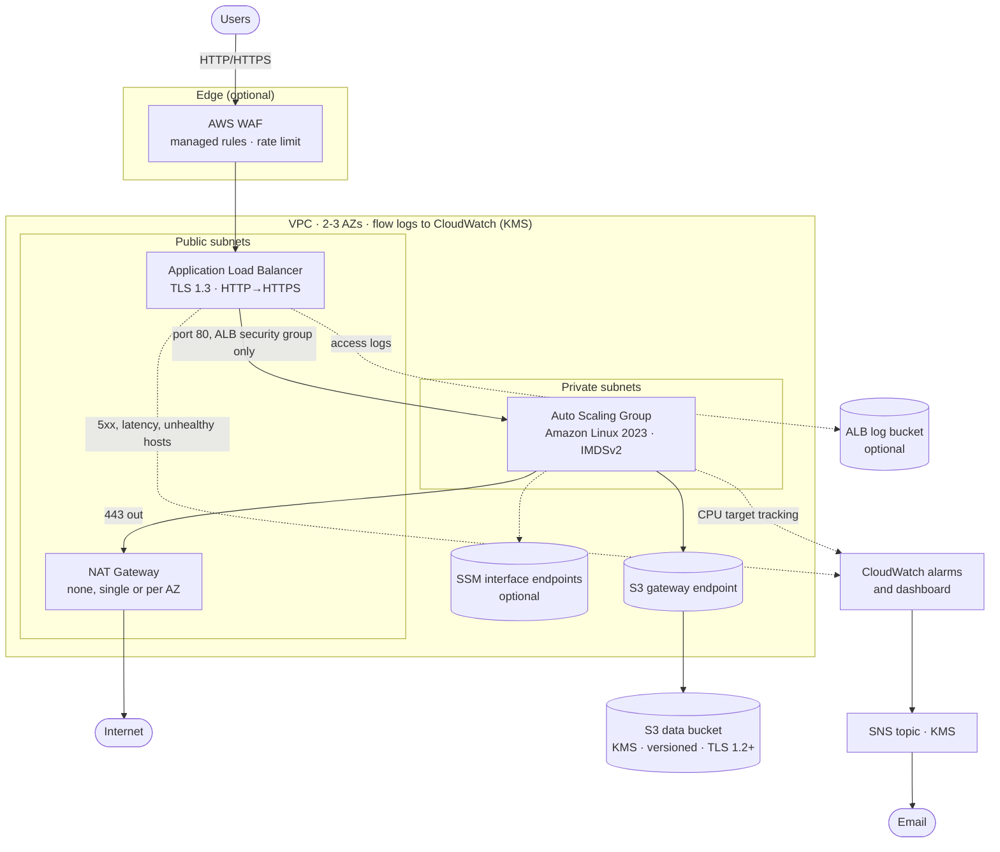
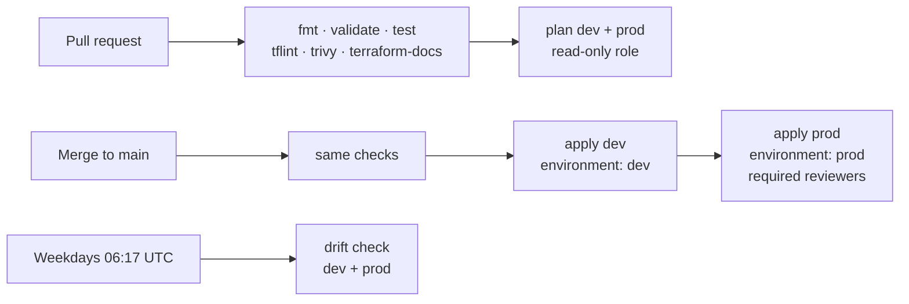

# Terraform AWS Starter Kit

[](https://github.com/anastanveer653/terraform-aws-starter-kit/actions/workflows/terraform.yml)
[](https://github.com/anastanveer653/terraform-aws-starter-kit/actions/workflows/drift.yml)


[](LICENSE)

A production-shaped, highly available web tier on AWS: an Application Load Balancer behind AWS WAF, an Auto Scaling Group in private subnets, and the security, observability and delivery pipeline around it. Every module is tested, linted, security-scanned and documented in CI.

There is no bastion host and no SSH. Instances are reached through AWS Systems Manager, and nothing on the internet can reach them except through the load balancer.

## Highlights

- **Secure by default.** IMDSv2 only, KMS everywhere it is supported, TLS 1.2+ enforced on S3, the default security group stripped, least-privilege IAM, and trust policies with confused-deputy protection. trivy reports zero findings, and each accepted risk is documented next to its code.
- **Edge protection.** Optional AWS WAF with managed rule groups and a per-IP rate limit, logs with credentials redacted, and ALB access logs in a dedicated bucket.
- **Keyless, gated delivery.** GitHub Actions authenticates to AWS with OIDC. Pull requests plan with a role that cannot write anything. Merges to `main` apply dev and then prod, each gated by a GitHub environment. A weekday drift check catches console changes.
- **Tested without an AWS account.** 20 `terraform test` cases run against a mocked provider and cover topology, security controls, feature toggles and input validation, so CI needs no credentials and costs nothing.
- **Observable.** Five CloudWatch alarms (5xx, unhealthy hosts, p95 latency, CPU), an SNS topic encrypted with KMS, a ready-made dashboard, and VPC flow logs.
- **Cost-aware.** NAT can be `none`, `single` or `per_az`. A free S3 gateway endpoint keeps package downloads off the NAT, and the README prices every environment.

## Architecture



## What it builds

| Module | Resources | Notable choices |
|---|---|---|
| [`vpc`](modules/vpc) | VPC, public and private subnet per AZ, IGW, NAT, route tables, endpoints, flow logs | Subnets keyed by AZ, so adding an AZ never renumbers existing ones. Default security group stripped. Flow-log role trusts only this account's flow logs. |
| [`alb`](modules/alb) | ALB, target group, listeners, security group, optional access-log bucket | TLS 1.3 policy and HTTP-to-HTTPS redirect when a certificate is set. Invalid headers dropped. Target group replaces itself safely with `create_before_destroy`. |
| [`waf`](modules/waf) | Web ACL, association, encrypted log group | IP reputation list, rate limit, common rule set and known bad inputs. `authorization` and `cookie` headers redacted from logs. |
| [`ec2`](modules/ec2) | Launch template, Auto Scaling Group, scaling policy, IAM role | IMDSv2 only, encrypted gp3, ELB health checks, rolling instance refresh, CPU target tracking. AMI pinned or tracked from SSM. IAM scoped to one bucket and one key. |
| [`s3`](modules/s3) | Hardened bucket | SSE-KMS or SSE-S3, versioning, ACLs disabled, public access blocked, HTTP and TLS < 1.2 denied, lifecycle to IA, Glacier, then expiry. Reused for the access-log bucket. |
| [`kms`](modules/kms) | Customer-managed key and alias | Automatic rotation. CloudWatch Logs scoped by encryption context, CloudWatch alarms by source account. |
| [`monitoring`](modules/monitoring) | SNS topic, 5 alarms, dashboard | ALB 5xx, target 5xx, unhealthy hosts, p95 latency, sustained high CPU. |
| [`bootstrap/`](bootstrap) | State bucket, state KMS key, GitHub OIDC provider, CI roles | S3 native state locking (no DynamoDB). Read-only plan role; opt-in apply role that only GitHub environments can assume. |

Every module README lists its inputs and outputs, generated by [terraform-docs](https://terraform-docs.io) and checked in CI.

## Environments

One root module, configured per environment by a variables file and a backend file in [`environments/`](environments):

| | `dev` | `staging` | `prod` |
|---|---|---|---|
| Availability zones | 2 | 2 | 3 |
| NAT Gateways | 1 shared | 1 shared | 1 per AZ |
| SSM interface endpoints | off | off | on |
| Instances (min / desired / max) | 1 / 1 / 2 | 2 / 2 / 4 | 2 / 2 / 6 |
| Instance type | t3.micro | t3.small | t3.small |
| WAF | off | on | on |
| ALB access logs | off | 30 days | 365 days |
| Flow log retention | 14 days | 30 days | 90 days |
| ALB deletion protection | off | off | on |

## Quick start

**Prerequisites:** Terraform ≥ 1.11, the AWS CLI with credentials for the target account, and the [Session Manager plugin](https://docs.aws.amazon.com/systems-manager/latest/userguide/session-manager-working-with-install-plugin.html) for shell access.

### 1. Bootstrap (once per account)

```bash
cd bootstrap
terraform init
terraform apply -var 'github_repository=<owner>/<repo>'
```

Copy `state_bucket_name` and `state_kms_key_arn` from the outputs into `environments/*.s3.tfbackend`.

Bootstrap keeps its own state locally, so back up `bootstrap/terraform.tfstate` (it is gitignored).

### 2. Deploy an environment

```bash
make init plan ENV=dev   # terraform init + plan into dev.tfplan
make apply ENV=dev       # apply exactly that saved plan
```

Open the `app_url` output. Each refresh shows which instance and AZ served the request. The `dashboard_url` output opens the CloudWatch dashboard.

### 3. Get a shell on an instance

```bash
aws ssm start-session --target <instance-id>
```

The `list_instances_command` output prints the command that lists running instance IDs.

### 4. Tear down

```bash
make destroy ENV=dev
```

## CI/CD



| Workflow | Trigger | What it does |
|---|---|---|
| [`terraform.yml`](.github/workflows/terraform.yml) | PR, push to `main` | Formatting, validation of the stack and bootstrap, 20 tests, tflint, trivy (fails on medium or higher), README freshness. Plans on PRs; applies on `main`. |
| [`apply.yml`](.github/workflows/apply.yml) | Called by `terraform.yml` | Plans and applies one environment inside a GitHub environment, so its protection rules gate the run. Never cancelled mid-apply. |
| [`drift.yml`](.github/workflows/drift.yml) | Weekdays, manual | `plan -detailed-exitcode` against live infrastructure; fails and writes a summary when anything has drifted. |

Actions are pinned to commit SHAs, downloaded binaries are checksum-verified, and Dependabot keeps actions and providers current.

### Turning on plans and applies

1. Bootstrap with `-var create_github_apply_role=true` if you want CI to apply.
2. In **Settings → Environments**, create `dev` and `prod`, and add required reviewers to `prod`.
3. In **Settings → Variables**, set `TF_STATE_BUCKET`, `TF_STATE_KMS_KEY_ARN`, `AWS_PLAN_ROLE_ARN` and (optionally) `AWS_APPLY_ROLE_ARN` from the bootstrap outputs.

Without these variables the plan, apply and drift jobs skip themselves, so forks stay green.

## Security

| Control | Where |
|---|---|
| No inbound path to instances except from the ALB security group | [`modules/ec2`](modules/ec2/main.tf) |
| IMDSv2 required, hop limit 1 | [`modules/ec2`](modules/ec2/main.tf) |
| Customer-managed KMS key with rotation for S3, logs and SNS | [`modules/kms`](modules/kms/main.tf) |
| S3: public access blocked, ACLs disabled, HTTP and TLS < 1.2 denied | [`modules/s3`](modules/s3/main.tf) |
| WAF managed rules and rate limiting; secrets redacted from logs | [`modules/waf`](modules/waf/main.tf) |
| Flow-log and WAF log delivery scoped by `aws:SourceAccount` / `aws:SourceArn` | [`modules/vpc`](modules/vpc/main.tf), [`modules/waf`](modules/waf/main.tf) |
| CI plan role: read-only, trusted only for PRs and `main` | [`bootstrap`](bootstrap/main.tf) |
| CI apply role: opt-in, trusted only for named GitHub environments | [`bootstrap`](bootstrap/main.tf) |
| State: versioned, KMS-encrypted bucket with S3 native locking | [`bootstrap`](bootstrap/main.tf) |

### Accepted risks

Four scanner findings are suppressed inline, each with its reason next to the code:

- The load balancer is internet-facing because it is the entry point. Restrict it with `alb_ingress_cidrs`, and put WAF in front.
- Without a certificate the HTTP listener forwards traffic. Set `certificate_arn` and it redirects to HTTPS. A `check` block warns when prod has no certificate.
- Instances allow outbound 443 to any address, because AWS public endpoints have no fixed range.
- The ALB access-log bucket uses SSE-S3, because ALB log delivery does not support customer-managed keys.

Found a vulnerability? See [SECURITY.md](SECURITY.md).

## Testing

[`tests/main.tftest.hcl`](tests/main.tftest.hcl) uses Terraform's native test framework with a mocked AWS provider, so it needs no account and costs nothing:

| Area | Cases |
|---|---|
| Topology | Subnets per AZ, NAT count per mode, the no-egress warning |
| Security | IMDSv2, S3 public access block, HTTP vs HTTPS listener behaviour, prod-without-certificate warning |
| Features | WAF and access logs off by default and wired when on, AMI pinning vs SSM tracking, dashboard link |
| Validation | Unknown environment or NAT mode, bad project name, too many AZs, malformed AMI ID, unsafe WAF rate limit |

```bash
make check   # fmt, validate, test, tflint, trivy, terraform-docs — everything CI runs
```

## Operations notes

- **AMI updates.** Without `ami_id`, each new Amazon Linux 2023 release changes the launch template, and the next apply rolls every instance (at least 50% stay healthy throughout). Pin `ami_id` in prod so new AMIs arrive through a reviewed change. The drift check flags a pending AMI update.
- **Scaling.** The scaling policy owns `desired_capacity` after the first apply; Terraform ignores it from then on.
- **Partitions.** ARNs are built from `aws_partition`, so the stack is not tied to the commercial `aws` partition.

## Cost

Approximate us-east-1 on-demand prices before data transfer and load balancer capacity units. Check the [AWS pricing calculator](https://calculator.aws/) for your region.

| Item | dev | staging | prod |
|---|---|---|---|
| NAT Gateway (~$33/month each) | ~$33 | ~$33 | ~$99 |
| Application Load Balancer | ~$16 | ~$16 | ~$16 |
| EC2 | ~$8 (1 × t3.micro) | ~$30 (2 × t3.small) | ~$30 (2 × t3.small) |
| Public IPv4 addresses (~$3.65/month each: NAT EIPs + one ALB address per AZ) | ~$11 | ~$11 | ~$22 |
| SSM interface endpoints (~$7/month per endpoint per AZ) | none | none | ~$66 |
| WAF (web ACL + 4 rules, before request charges) | none | ~$9 | ~$9 |
| KMS, EBS, logs, dashboard | ~$3 | ~$5 | ~$8 |
| **Total** | **~$71/month** | **~$104/month** | **~$250/month** |

For a short demo, apply `dev`, test it, and destroy it the same day. Setting `nat_gateway_mode = "none"` with `enable_ssm_endpoints = true` removes the NAT; Amazon Linux packages still install through the free S3 gateway endpoint.

## Layout

```
.
├── main.tf  variables.tf  outputs.tf  provider.tf    root module
├── environments/        dev, staging, prod: variables and backend config
├── modules/
│   ├── vpc/  alb/  waf/  ec2/  s3/  kms/  monitoring/
├── bootstrap/           state bucket, state key, GitHub OIDC roles
├── tests/               terraform test suite (mocked AWS)
├── .github/             CI, apply, drift, Dependabot, templates
└── Makefile  .tflint.hcl  .terraform-docs.yml  .pre-commit-config.yaml
```

## Roadmap

- [x] ALB access logs to a dedicated S3 bucket
- [x] AWS WAF in front of the load balancer
- [x] Apply job gated by GitHub environment approval
- [x] Scheduled drift detection
- [ ] Route 53 record and ACM certificate with DNS validation
- [ ] RDS in isolated subnets with Secrets Manager
- [ ] Integration test that applies `dev` to a sandbox account and checks the endpoint

## Contributing

Issues and pull requests are welcome. Start with [CONTRIBUTING.md](CONTRIBUTING.md); `make check` runs everything CI does.

## Reference

Inputs and outputs of the root module. Each module documents its own in its README.

<!-- BEGIN_TF_DOCS -->
## Requirements

| Name | Version |
| ---- | ------- |
| terraform | >= 1.11.0 |
| aws | ~> 6.0 |

## Providers

| Name | Version |
| ---- | ------- |
| aws | ~> 6.0 |

## Modules

| Name | Source | Version |
| ---- | ------ | ------- |
| alb | ./modules/alb | n/a |
| ec2 | ./modules/ec2 | n/a |
| kms | ./modules/kms | n/a |
| monitoring | ./modules/monitoring | n/a |
| s3 | ./modules/s3 | n/a |
| vpc | ./modules/vpc | n/a |
| waf | ./modules/waf | n/a |

## Resources

| Name | Type |
| ---- | ---- |
| [aws_availability_zones.available](https://registry.terraform.io/providers/hashicorp/aws/latest/docs/data-sources/availability_zones) | data source |
| [aws_caller_identity.current](https://registry.terraform.io/providers/hashicorp/aws/latest/docs/data-sources/caller_identity) | data source |
| [aws_partition.current](https://registry.terraform.io/providers/hashicorp/aws/latest/docs/data-sources/partition) | data source |

## Inputs

| Name | Description | Type | Default | Required |
| ---- | ----------- | ---- | ------- | :------: |
| environment | Deployment environment. | `string` | n/a | yes |
| project\_name | Short name used as a prefix for every resource. Lowercase letters, digits and hyphens, 3-20 characters. | `string` | n/a | yes |
| alarm\_email | Email address subscribed to alarm notifications. Leave empty to skip. | `string` | `""` | no |
| alb\_access\_log\_retention\_days | Days to keep load balancer access logs. | `number` | `90` | no |
| alb\_ingress\_cidrs | CIDR blocks allowed to reach the load balancer. | `list(string)` | <pre>[<br/>  "0.0.0.0/0"<br/>]</pre> | no |
| ami\_id | Pin the instance AMI. Null tracks the latest Amazon Linux 2023, so every new AMI release rolls the instances on the next apply. | `string` | `null` | no |
| asg\_desired\_capacity | Initial number of application instances. Autoscaling adjusts it afterwards. | `number` | `1` | no |
| asg\_max\_size | Maximum number of application instances. | `number` | `3` | no |
| asg\_min\_size | Minimum number of application instances. | `number` | `1` | no |
| aws\_region | AWS region to deploy into. | `string` | `"us-east-1"` | no |
| az\_count | Number of availability zones to spread subnets across. | `number` | `2` | no |
| certificate\_arn | ACM certificate ARN. When set, the ALB serves HTTPS and redirects HTTP to it. | `string` | `""` | no |
| cpu\_target\_utilization | Average CPU percentage the Auto Scaling Group tries to hold. | `number` | `50` | no |
| enable\_alb\_access\_logs | Write load balancer access logs to a dedicated S3 bucket. | `bool` | `false` | no |
| enable\_deletion\_protection | Protect the load balancer from accidental deletion. | `bool` | `false` | no |
| enable\_ssm\_endpoints | Create interface endpoints for Systems Manager so instances can be managed without a NAT Gateway. | `bool` | `false` | no |
| enable\_waf | Put an AWS WAF web ACL (managed rules and a per-IP rate limit) in front of the load balancer. | `bool` | `false` | no |
| flow\_log\_retention\_days | Days to keep VPC flow logs and WAF logs in CloudWatch. | `number` | `30` | no |
| instance\_type | EC2 instance type for the application tier. | `string` | `"t3.micro"` | no |
| nat\_gateway\_mode | Outbound internet for private subnets: none, single (one shared NAT, cheaper) or per\_az (one per AZ, highly available). | `string` | `"single"` | no |
| s3\_force\_destroy | Allow terraform destroy to delete the data bucket even when it contains objects. | `bool` | `false` | no |
| tags | Extra tags applied to every resource. | `map(string)` | `{}` | no |
| vpc\_cidr | CIDR block for the VPC. Subnets are carved out of it automatically. | `string` | `"10.0.0.0/16"` | no |
| waf\_rate\_limit | Requests per 5 minutes a single IP may send before WAF blocks it. | `number` | `2000` | no |

## Outputs

| Name | Description |
| ---- | ----------- |
| alarm\_topic\_arn | SNS topic that receives CloudWatch alarm notifications. |
| alb\_access\_logs\_bucket | Bucket receiving load balancer access logs, or null when they are off. |
| ami\_id | AMI the application instances launch from. |
| app\_url | URL of the application load balancer. |
| asg\_name | Name of the application Auto Scaling Group. |
| dashboard\_url | CloudWatch dashboard for traffic, errors, latency, host health and CPU. |
| data\_bucket\_name | Name of the encrypted application data bucket. |
| kms\_key\_arn | ARN of the customer-managed KMS key. |
| list\_instances\_command | Command that lists the running application instances, to open an SSM session on one. |
| nat\_gateway\_count | Number of NAT Gateways created. |
| private\_subnet\_ids | Private subnet IDs (application instances). |
| public\_subnet\_ids | Public subnet IDs (load balancer and NAT). |
| vpc\_id | ID of the VPC. |
| waf\_web\_acl\_arn | ARN of the WAF web ACL, or null when WAF is off. |
<!-- END_TF_DOCS -->

## License

[MIT](LICENSE) © Anas Tanveer
